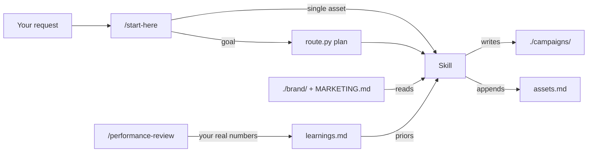

# System Guide: how Boring Marketing Skills works

This is the one page to read after installing. It explains what happens when you type a
request, where your files live, and how the system gets sharper the longer you use it.
The library works for any business (software, online shops, creators, agencies) and
carries a local-business pack for plumbers, roofers, dentists and the agencies that
serve them. If you only want to start: install, then type `/start-here` and name the
business.

## Install

| Path | Command | Where skills land |
|---|---|---|
| Any agent (Claude Code, Codex, Cursor and others) | `npx skills add boringmarketer/boring-marketing-skills` | `.agents/skills/<name>/` in your project, with `.claude/skills/<name>` linked to it for Claude Code. Add `-g` for every project. |
| Claude Code plugin | `/plugin marketplace add boringmarketer/boring-marketing-skills` then `/plugin install boring-marketing@boring-marketing-skills` | The plugin cache. Skills carry a prefix: `/boring-marketing:start-here`. The hooks (client isolation, asset registration) load automatically. |
| Installer script | `_system/scripts/install.sh` from a clone | `~/.claude/skills/` plus `~/.claude/_system/` |

Same skills on every path. This guide uses the short form (`/start-here`). The shared
runtime scripts (`brand_context.py`, `capability.py`, `route.py`) ship inside
`start-here/scripts/`, so every path can load your brand files; skills call them as
`<skill folder>/../start-here/scripts/...`. If python3 is missing, a skill reads the
brand folder directly.

## How it works in one minute

1. You name the business (or paste its URL) to `/start-here`. The **lite read** takes
   about 3 minutes: it reads the site and what customers say (Google reviews for a local
   business, review sites for software and shops), finds who shows up first, writes the
   core brand files to `./brand/`, and names one first move. Say **deep** for the full
   foundation: four research agents in parallel, about 15 minutes.
2. From then on you talk to `/start-here` in plain language: "what should I do next",
   "review my site", "get more Google reviews", "new client acme.com", "find clients".
   It routes you to the right skill or chain of skills and says why in one line.
3. Every skill reads only the brand files it needs, writes its deliverable to
   `./campaigns/<name>/` (or its own brand file), registers the asset, and ends with two
   to four next steps.
4. `/performance-review` turns your real numbers into learnings that every other skill
   applies next time.
5. Nothing publishes, sends, or spends without you. Drafts and files, always.

No API keys are required. Every skill works with your agent's own web search and fetch
plus the files you give it. Keys and tools deepen research and let skills act; see Tools
below and `TOOLS.md`.

## Your files

Everything lives in your project folder, not in the skill install. Updates never touch it.

### `./brand/`: brand memory

| File | Written by | What it holds |
|---|---|---|
| `brand.yaml` | `/start-here`, then any skill that updates a profile file | Manifest: name, URL, business facts (category, services; for a local business the phone, town, service area and rating as seen), which files exist, when each changed, active campaigns. Every skill sees the business facts. |
| `voice-profile.md` | `/start-here` (lite), `/brand-voice` | How you sound: tone, sentence length, vocabulary, platform adaptations |
| `positioning.md` | `/start-here` (lite), `/positioning-angles` | What you promise now, the chosen angle, runners-up |
| `audience.md` | `/start-here` (lite), `/audience-research` | Segments, pain language, buying triggers |
| `voc.md` | `/start-here` (lite), `/audience-research` | Verbatim customer quotes with source URLs; copy skills quote it, never paraphrase |
| `competitors.md` | `/start-here` (lite), `/competitive-intel` | Who shows up first, exploitable gaps, a watch baseline |
| `creative-kit.md` | `/creative` | Visual identity: colours, type, style, reference images |
| `keyword-plan.md` | `/keyword-research` | Topic clusters and their priorities |
| `social-canon.md` | `/social-content` | Your own best posts and the patterns behind them |
| `stack.md` | `/start-here` | Your goal (line 1) and which tools and keys are connected (names only, never values) |
| `preferences.md` | `/start-here`, or you | Standing preferences: banned phrases, channels you refuse, review rules, budget ceilings |
| `algo-cache.md` | any skill | Dated platform facts with an expiry; refreshed by web search when stale |
| `assets.md` | every skill (append-only) | One row per deliverable |
| `learnings.md` | `/performance-review` only (append-only) | What worked and what did not, with sample sizes |
| `.history/` | automatic | A dated copy of every profile file before it is overwritten |

Files from the lite read say `Depth: lite` at the top. "Deep" (or running the owning
skill) replaces them with the full version; the lite copy goes to `.history/`.

Say "remember that we never discount" or "always show me before sending" and
`/start-here` writes it to `preferences.md` and confirms in one line. Every skill reads
that file before it writes anything.

### `MARKETING.md`: your standing brief

Optional, at the workspace root. Think of it as a CLAUDE.md for your marketing: goals,
offers, constraints, priorities and a do-not-do list, in your own words. Every skill
loads it first, verbatim (up to 300 lines). `/start-here` offers to write it once after
the first run; say no and it never asks again. Edit it any time.

### `./campaigns/`: deliverables

One folder per piece of work: `./campaigns/spring-launch/`, `./campaigns/content/`,
`./campaigns/newsletters/`. Site reviews land in `./campaigns/audit/audit-<date>.md`; technical audits from `/site-audit` in `./campaigns/site-audit-<domain>-<date>/`.
Every file written here gets a row in `assets.md` (the plugin hook does this for you).

### `./campaigns/prospects-*/`: businesses you want as clients

`/find-local-clients` ranks the businesses in a trade and a town that are losing the most
customers; `/pitch-the-fix` writes the short email about one broken thing. A full
proposal (`/start-here prospect https://example.com`) goes to
`./campaigns/prospects-example/proposal.md`: findings with data labels, gaps ranked, a 90-day plan
mapped to skills, and what you would need from them. Never under `./brands/`, never with
invented traffic or revenue, never with pricing.

### `./brands/<client>/` and `./brands/active`: agency layout

Each client gets a full brand folder with the same layout as `./brand/`. The plain-text
file `./brands/active` holds the slug of the client you are working on. Every skill
resolves the brand folder in this order: an explicit `--brand <slug>`, then
`./brands/active`, then `./brand/`.

## What `/start-here` does with a request

1. **Quick Mode wins.** A specific single-asset request ("five headline variants", "reply
   to this review") goes straight to the skill. No scan, no status report, no setup
   pitch.
2. **Plain-language modes.** Say it; flags are shortcuts, never requirements.

| You say | What happens |
|---|---|
| a business name, a URL, "set up my business" | First run: the lite read (~3 min) |
| "deep", "go deep", "full foundation" | The four-agent foundation (~15 min), upgrading the lite files |
| "technical SEO audit", "crawl my site", "are AI crawlers blocked", "page speed" | `/site-audit`: a polite crawl of up to 200 pages (robots.txt, indexing, AI crawler access at robots.txt and the CDN, sitemaps, broken links, duplicate pages, Core Web Vitals) ranked into 5 to 10 fixes; the full findings in `./campaigns/site-audit-<domain>-<date>/` |
| "review my site", "what should I fix first", "audit" | Audit: a teardown of your homepage and the page your goal implies (read on a phone for a local business), a light AI-search check, and a delta against your competitors. Top three priorities in chat; the full list in `./campaigns/audit/` |
| "what should I do next" | Short status, one fetch of your homepage, then one or two specific recommendations |
| "what should I add", "which API keys", "stack" | Stack advisor: missing toolsets ranked for your goal, one line each |
| "new client acme.com" | Agency: scaffold `./brands/acme/`, set it active, run the lite read there |
| "find clients", "who should I pitch" | `/find-local-clients`, then `/pitch-the-fix` |
| "switch to acme" | Agency: change `./brands/active` and confirm |
| "agency status" | One table across all clients, then the client most in need and the skill that fixes it |
| "prospect acme.com", "proposal for acme.com" | Prospect: site review plus a competitor teardown, written to `./campaigns/prospects-acme/proposal.md` |
| "remember that…", "never…" | Written to `preferences.md`, confirmed in one line |
| anything else | Goal routing |

3. **Goal routing.** A question ("what should my plan be?") gets an answer, not a run.
   For work you ask it to do, `/start-here` classifies the goal and runs `route.py`,
   which builds the plan from each skill's own declared inputs: which skills, in what
   order, which run in parallel, and which foundation files are missing. Goals for any
   business: traffic, leads, convert, authority, launch, unsure. Goals for the local
   pack: found (Google profile, local plan, town pages), chosen (reviews, first screen,
   the page), calls (tracking, speed to lead, ads, the pause test), and clients for
   agencies. A plan of three or more steps is shown first with time estimates; you run
   it all, start with step one, or pick a step.
4. **One advisor sentence, once.** If the plan would benefit from a key you do not have,
   you get one sentence naming the single most useful one, then the work continues
   without it.
5. **Project scan.** On first run and on audit, a `README.md`, `MARKETING.md`, `docs/`,
   `content/` or site source in your workspace is read first as evidence and labelled
   `Data: LOCAL DOCS`. Unpublished plans count as intent, not fact.

Every research deliverable says once, in a short "Sources and assumptions" note at the
end, whether it rests on live sources, your own documents or general knowledge, and
estimated numbers carry a `~`. Deliverables hold only the work: the evidence, scores and
tool output are saved to a notes file, not pasted into what you hand a client.

## Memory that learns

- **Selective loading.** Each skill declares which brand files it reads and writes. The
  loader (`brand_context.py`) emits exactly those, section by section where possible,
  with a freshness flag per file, plus the business facts from `brand.yaml`.
- **Learnings have one writer.** Only `/performance-review` writes `learnings.md`, and
  only from real numbers you give it (a CSV export, a screenshot, a call log or a
  read-only analytics pull). Every generator reads it and applies the priors that fit.
- **Nothing is lost.** Before a profile file is overwritten, a dated copy goes to
  `./brand/.history/`, and a three-line summary says what changed.
- **Append-only registers.** `assets.md` and `learnings.md` are never truncated or
  reordered.
- **Quiet context.** The work shows what shaped it. A skill speaks up in one line only
  when a file is stale or conflicts with what you just said, so stale memory still gets
  caught.

Freshness flags: under 7 days, loaded as is; 7 to 30 days, dated; 30 to 90 days, flagged
as possibly stale; over 90, the owning skill is named for a refresh.

## Freshness

Platform facts go stale. Anything perishable (algorithm behaviour, ad specs, Google
Business Profile rules, model IDs and prices, deliverability rules) lives in a skill's
`references/` folder under a header: `last-verified: <date> · ttl-days: <n> · refresh:
<how>`. When a skill needs a fact that has expired, it refreshes it by the stated
instruction, updates your local copy (or `./brand/algo-cache.md`), and tells you in one
line. `python3 _system/scripts/refresh_check.py <file>` reports any file past its expiry.
Each release re-verifies every dated file before it ships.

## Agency mode

- **Onboarding a client** takes about 3 minutes: "new client acme.com" scaffolds
  `./brands/acme/`, sets it active, and runs the lite read. Say "deep" when the retainer
  covers strategy work.
- **Finding clients.** `/find-local-clients` and `/pitch-the-fix` work from free data (the
  rating, review count, site and owner replies anyone can see). A paid tool can speed up
  the same steps; each skill names it after the free path.
- **Keys per client.** Put a client's keys in `./brands/acme/.env`. They override the
  workspace `.env` for that client only. No skill ever shows a value.
- **Every client at once.** "Run the competitor watch for every client" (or
  `route.py --all-brands --goal <goal>`) visits each client folder that has a
  `brand.yaml`, writes into that client's own folders, and ends with one rollup line per
  client.
- **Isolation.** With the plugin hooks, a write into a client folder that is not the
  active one is blocked. In other agents the skills hold the same rule: one client per
  session, writes only under the active client's folder.

## Tools

Every skill works with your agent's own web access. Some do more when you connect a
tool, and when a skill names a paid tool it gives the free way too.

| Job | What we use | Used by |
|---|---|---|
| Web search, page reads | Exa, Firecrawl | the research skills, `ai-search`, `first-screen-check`, `site-audit` |
| Search volumes, SERPs | DataForSEO (treg as the one-key alternative) | `keyword-research`, `local-seo-plan`, `programmatic-seo` |
| Images, video, voiceover | GPT Image, Seedance 2.5 via Higgsfield or Replicate, ElevenLabs | `creative` |
| Meta and Google ads | Meta's official Ads MCP server and Ads CLI, Google Ads API | `meta-ads`, `paid-ads`, `google-ads-tracking` |
| Posting and scheduling | Zernio (Buffer for a few free channels) | `social-content`, `content-atomizer`, `google-business-profile` |
| Search Console, Business Profile | Google, free | `local-seo-plan`, `google-business-profile`, `performance-review`, `site-audit` |
| Core Web Vitals | Google's PageSpeed Insights and CrUX APIs, free with a key | `site-audit` |
| Finding local businesses to pitch | boringfunnels (made by the author of this library) | `find-local-clients`, `pitch-the-fix`, `first-screen-check` |

The author's own tool is marked wherever a skill mentions it, never replaces the free
path, and no skill needs it. Keys, costs and sign-up paths: `TOOLS.md`.

## Automations

Recipes live in `automations/`. Every one is non-interactive, produces dated drafts and
reports only, and never publishes, sends, or spends.

- **Five routines** (`automations/routines/`): weekly competitor watch, AI citation
  monitor, monthly performance review, weekly content ritual, brand health check.
- **Two workflows** (`automations/workflows/`): full-funnel build and campaign fan-out,
  parallel builds behind a QA gate.
- **Two hooks** (`automations/hooks/hooks.json`): client isolation before a write, asset
  registration after a write. Plugin installs load them automatically; with other paths
  they are optional (Claude Code: add the entries to your hooks settings).

Three ways to run a routine: paste its prompt into `/schedule` in Claude Code; put its
cron line on a machine that can open the workspace; or say "for every client" for the
agency variant. A cloud routine runs in a fresh clone of your repo and sees only skills
committed to that repo, so install with `npx skills add` (project scope) and commit the
`.agents/skills/` folder first.

## Updating

- **npx path.** `npx skills update` (or `npx skills add boringmarketer/boring-marketing-skills` again).
- **Plugin path.** `claude plugin marketplace update boring-marketing-skills` and
  `claude plugin update boring-marketing@boring-marketing-skills`. Restart Claude Code.
- **Installer path.** Pull the new release and run `_system/scripts/install.sh` again,
  then `_system/scripts/doctor.sh` to confirm every check passes.

Brand memory and campaigns live in your project folder, so no path touches them.
`CHANGELOG.md` says what changed in each release.

## The loop in one picture

